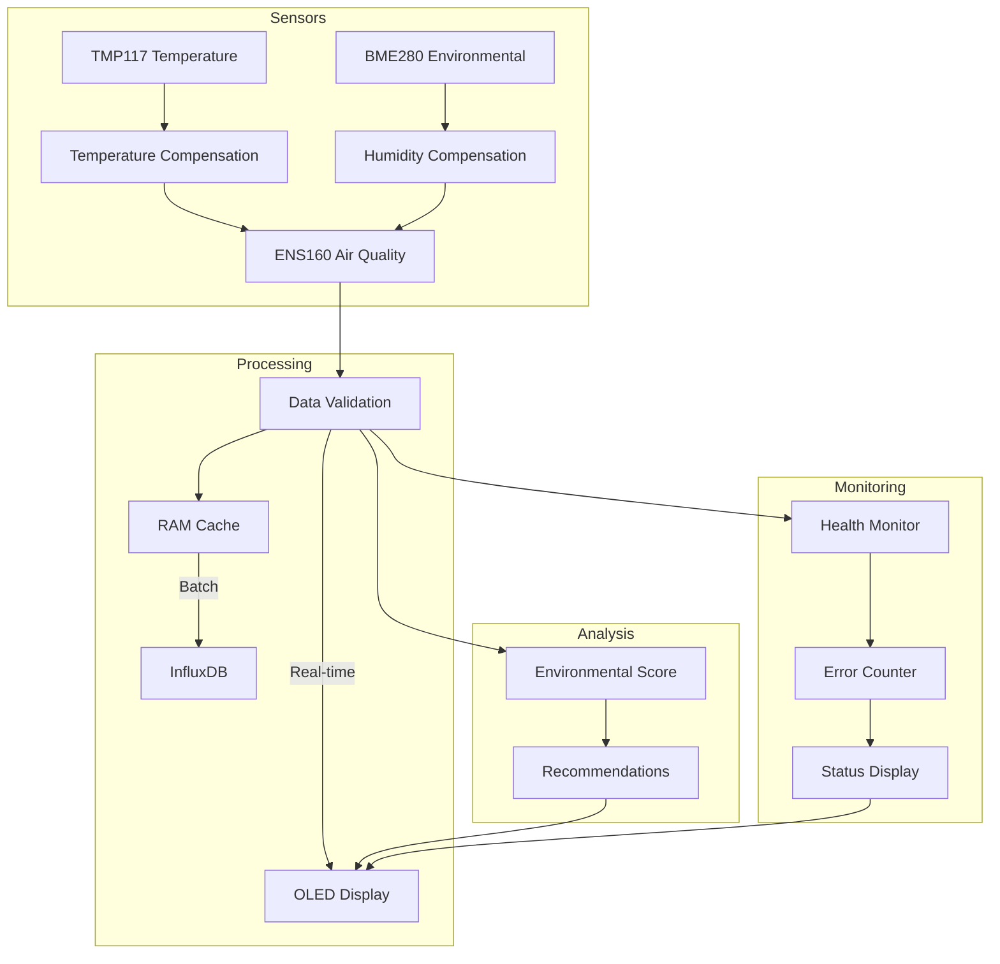

# Raspberry Pi Environmental Monitoring System

Real-time indoor air quality and environmental monitoring using multiple sensors connected to a Raspberry Pi, with OLED display output and InfluxDB data logging.

## Hardware

- **ENS160** — Air Quality Sensor (VOC, eCO2, AQI)
- **BME280** — Environmental Sensor (Temperature, Pressure, Humidity)
- **TMP117** — High-Precision Temperature Sensor
- **SSD1306** — 128×64 OLED Display

## Features

- Real-time monitoring of temperature, humidity, pressure, AQI, TVOC, and eCO2
- Multi-page OLED display with temperature graphing and environmental recommendations
- Automatic data validation and sensor health tracking
- Batch data transmission to InfluxDB with RAM-based caching
- Graceful error handling with automatic recovery
- UBA (German Federal Environmental Agency) guideline compliance

## Project Structure

```
pi-sensor/
├── ens160AirQualitySensor.py    # Main monitoring application
├── requirements.txt
├── docs/
│   ├── air-quality-guide.md     # Interpreting sensor readings
│   ├── ENS160.md                # ENS160 sensor reference
│   └── SSD1306.md               # SSD1306 display API reference
├── examples/
│   ├── display/                 # SSD1306 OLED display examples
│   ├── sensors/                 # DHT22 sensor scripts
│   └── buzzer/                  # PiicoDev buzzer example
└── assets/                      # Bitmap images for display
```

## System Architecture



## Display Pages

The OLED cycles through five pages:

1. **Main Stats** — Temperature, humidity, pressure, AQI rating
2. **Air Quality** — AQI score, TVOC (ppb), eCO2 (ppm)
3. **Temp Graph** — Rolling temperature history with min/max
4. **Sensor Health** — Error counts per sensor (shown only when issues exist)
5. **Environment** — Comfort score and actionable recommendations

## Installation

### Prerequisites

```bash
sudo apt-get update
sudo apt-get install -y python3-pip python3-smbus i2c-tools

# Enable I2C
sudo raspi-config  # Interface Options → I2C → Enable

# Verify sensors are detected
sudo i2cdetect -y 1
```

### Setup

```bash
pip3 install -r requirements.txt
export INFLUXDB_TOKEN="your-token-here"
```

### Configuration

Edit the `CONFIG` dictionary in `ens160AirQualitySensor.py`:

```python
CONFIG = {
    'MEASUREMENT_INTERVAL_MS': 1000,
    'INFLUXDB': {
        'URL': "http://your-influx-server:8086",
        'ORG': "your-org",
        'BUCKET': "sensorData",
    },
    'SENSOR_LOCATION': "room-name",
}
```

### Run

```bash
python3 ens160AirQualitySensor.py
```

### Run as a Service (optional)

```bash
sudo nano /etc/systemd/system/air-quality.service
```

```ini
[Unit]
Description=Air Quality Monitoring
After=network.target

[Service]
Environment=INFLUXDB_TOKEN=your-token-here
ExecStart=/usr/bin/python3 /path/to/ens160AirQualitySensor.py
WorkingDirectory=/path/to/script/directory
Restart=always
User=pi

[Install]
WantedBy=multi-user.target
```

```bash
sudo systemctl enable air-quality
sudo systemctl start air-quality
```

## InfluxDB Data Schema

```
Measurement: sensorReading
Tags:    sensor, location
Fields:  temperature, humidity, pressure, aqi, tvoc, eco2, aqi_rating, eco2_rating, sensor_status
```

## Troubleshooting

| Problem                 | Check                                              |
|-------------------------|----------------------------------------------------|
| Sensor not found        | I2C connections, `sudo i2cdetect -y 1`, power      |
| InfluxDB errors         | Network, token permissions, bucket exists           |
| Display issues          | I2C address conflicts, power supply                 |
| ENS160 not ready        | Allow warm-up period (up to a few minutes)          |

Logs are written to stdout. Monitor with:

```bash
journalctl -u air-quality -f          # if running as service
python3 ens160AirQualitySensor.py 2>&1 | tee sensor.log  # if running directly
```

## Documentation

- [Air Quality Reading Guide](docs/air-quality-guide.md) — Interpreting AQI, TVOC, and eCO2 values
- [ENS160 Sensor Reference](docs/ENS160.md) — Sensor outputs and standards
- [SSD1306 Display API](docs/SSD1306.md) — Display driver documentation
