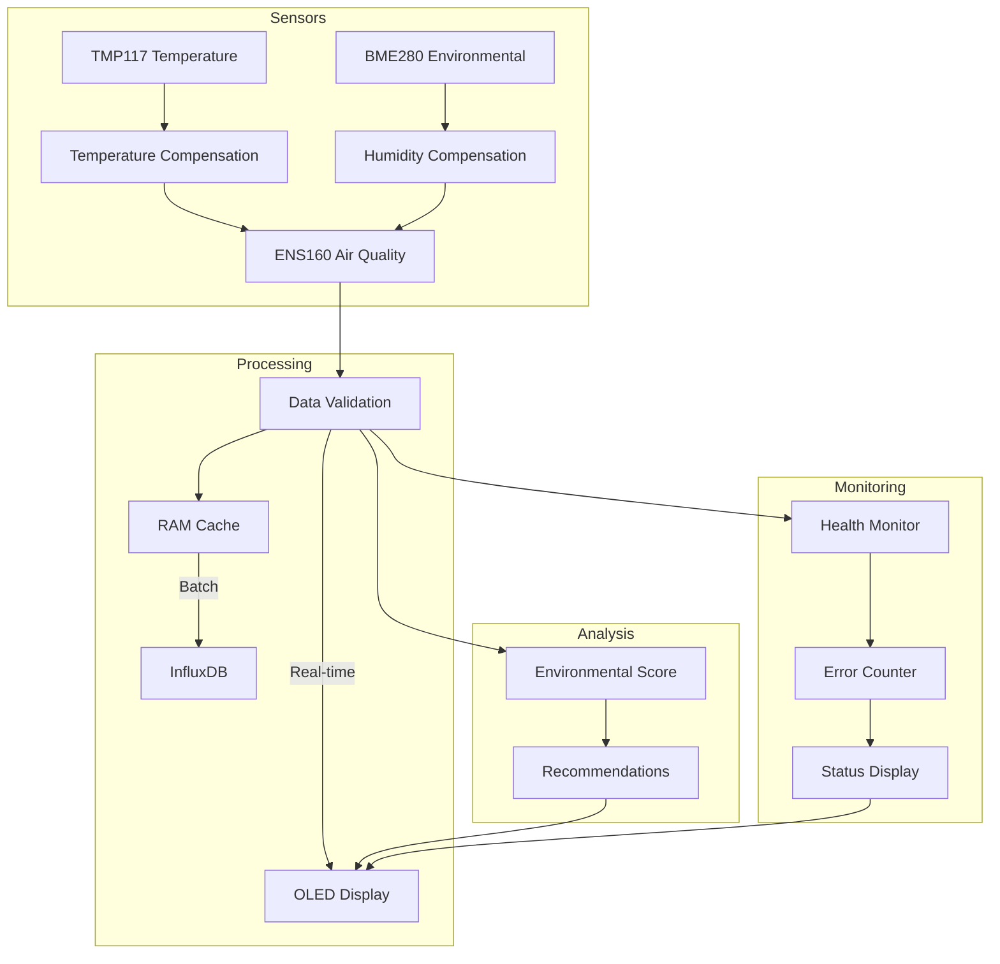

# Raspberry Pi Environmental Monitoring System

Real-time indoor air quality and environmental monitoring using multiple sensors connected to a Raspberry Pi, with OLED display output and InfluxDB data logging.

## Hardware

- **ENS160** — Air Quality Sensor (VOC, eCO2, AQI)
- **BME280** — Environmental Sensor (Temperature, Pressure, Humidity)
- **TMP117** — High-Precision Temperature Sensor
- **SSD1306** — 128×64 OLED Display
- **PiicoDev Buzzer** (optional): audible CO2 alarm

## Features

- Real-time monitoring of temperature, humidity, pressure, AQI, TVOC, and eCO2
- Multi-page OLED display with temperature graphing and environmental recommendations
- Automatic data validation and sensor health tracking
- Batch data transmission to InfluxDB with RAM-based caching
- Graceful error handling with automatic recovery
- UBA (German Federal Environmental Agency) guideline compliance

## Project Structure

```
pi-sensor/
├── ens160AirQualitySensor.py    # Main monitoring application
├── requirements.txt
├── deploy/                      # systemd unit + per-room env file template
├── docs/
│   ├── air-quality-guide.md     # Interpreting sensor readings
│   ├── ENS160.md                # ENS160 sensor reference
│   └── SSD1306.md               # SSD1306 display API reference
├── examples/
│   ├── display/                 # SSD1306 OLED display examples
│   ├── sensors/                 # DHT22 sensor scripts
│   └── buzzer/                  # PiicoDev buzzer example
└── assets/                      # Bitmap images for display
```

## System Architecture



## Display Pages

The OLED cycles through five pages:

1. **Main Stats** — Temperature, humidity, pressure, AQI rating
2. **Air Quality** — AQI score, TVOC (ppb), eCO2 (ppm)
3. **Temp Graph** — Rolling temperature history with min/max
4. **Sensor Health** — Error counts per sensor (shown only when issues exist)
5. **Environment** — Comfort score and actionable recommendations

## Installation

### Prerequisites

```bash
sudo apt-get update
sudo apt-get install -y python3-venv i2c-tools

# Enable I2C
sudo raspi-config  # Interface Options → I2C → Enable

# Verify sensors are detected
sudo i2cdetect -y 1
```

### Setup

Current Raspberry Pi OS / Debian blocks `pip install` into the system Python (PEP 668), so use a virtual environment inside the repo (`.venv/` is git-ignored):

```bash
python3 -m venv .venv
.venv/bin/pip install -r requirements.txt
export INFLUXDB_TOKEN="your-token-here"   # a write-only token for the bucket is enough
```

After an OS upgrade that changes the Python version, recreate it: `rm -rf .venv` and repeat the two commands above.

### Configuration

Each Pi is configured with environment variables, so the code is the same in every room. Defaults are in `CONFIG` in `ens160AirQualitySensor.py`.

| Variable | Default | Purpose |
|---|---|---|
| `INFLUXDB_TOKEN` | (required) | InfluxDB token; write-only access to the bucket is enough |
| `SENSOR_LOCATION` | `bedroom3` | Room name, stored as the `location` tag |
| `INFLUXDB_URL` | `http://192.168.1.10:8086` | InfluxDB server |
| `INFLUXDB_ORG` | `raider` | InfluxDB organisation |
| `INFLUXDB_BUCKET` | `sensorData` | InfluxDB bucket |
| `LOG_LEVEL` | `INFO` | `DEBUG` logs every reading; `INFO` logs status changes, errors and one line per upload |
| `CO2_ALARM_ENABLED` | `off` | Turns on the buzzer alarm |
| `CO2_ALARM_TRIGGER_PPM` | `1500` | Alarm when eCO2 stays above this threshold |
| `CO2_ALARM_CLEAR_PPM` | `1000` | Clear the alarm at or below this threshold |
| `CO2_ALARM_SUSTAIN_SEC` | `120` | Seconds of sustained high eCO2 before alarming |
| `CO2_ALARM_QUIET_HOURS` | `22-7` | Local hours without sound, or `off` |

Timing and buffering (`MEASUREMENT_INTERVAL_MS`, `POINT_INTERVAL_SEC`, `SEND_INTERVAL_SEC`, `CACHE.MAX_SIZE`, `GRAPH_SAMPLE_INTERVAL_SEC`) are only set in `CONFIG`.

### Run

```bash
.venv/bin/python ens160AirQualitySensor.py
```

### Run as a Service (optional)

Settings and the token live in `/etc/pi-sensor.env`, readable only by root. Unit files are world-readable and `systemctl show` prints their environment, so don't put the token in the unit file.

```bash
sudo install -m 600 -o root -g root deploy/pi-sensor.env.example /etc/pi-sensor.env
sudo nano /etc/pi-sensor.env                       # set INFLUXDB_TOKEN and SENSOR_LOCATION
sudo cp deploy/air-quality.service /etc/systemd/system/
sudo nano /etc/systemd/system/air-quality.service  # only if your user or path isn't pi / ~/pi-sensor
sudo systemctl daemon-reload
sudo systemctl enable --now air-quality
journalctl -u air-quality -f                       # look for "Location: <room>"
```

### Adding another room

Clone the repo on the new Pi, follow Setup, then the steps above with a different `SENSOR_LOCATION`. Every room writes to the same bucket, separated by the `location` tag, so Grafana panels can filter or group by `location`.

### CO2 alarm

With a PiicoDev Buzzer connected and `CO2_ALARM_ENABLED=1`, the monitor beeps three times when eCO2 stays
above 1500 ppm (the "Ventilate now!" band) for 2 minutes, then again every 10 minutes until it is back to 1000 ppm or below. During quiet hours
(default 22:00 to 07:00, Pi local time) it stays silent. While the alarm is on, the display drops its usual pages
for a full-screen alert with the current eCO2, how long it has been high and the level it clears at. The alert
flashes once a second, except in quiet hours, where it stays steady so it doesn't light up a dark room.
eCO2 is estimated from VOCs by the ENS160, so treat the alarm as a prompt to ventilate, not a safety device.

### Latest reading for other programs

Set `LATEST_READING_PATH` (e.g. `/run/pi-sensor/latest.json`) and each averaged point is also written there, once per `POINT_INTERVAL_SEC`:

```json
{"location": "bedroom3", "time": 1760266800.1, "tempC": 22.84, "humRH": 51.2, "eco2": 612}
```

`time` is Unix seconds when the point was closed; treat the reading as stale if it is more than a few minutes old. The file is replaced atomically and is world-readable, so readers never see a half-written file. The aircon's per-room control (`room_control.py` in [actron-local](https://github.com/jordauld1/actron-local)) reads it. The service's `RuntimeDirectory=pi-sensor` creates `/run/pi-sensor` on start.

## InfluxDB Data Schema

```
Measurement: sensorReading
Tags:    sensor, location
Fields:  temperature, humidity, pressure, aqi, tvoc, eco2, aqi_rating, eco2_rating, sensor_status
Time:    end of each averaging window (one point per POINT_INTERVAL_SEC), not upload time
```

Each point is the mean of the valid readings in its window (aqi, tvoc and eco2 rounded to integers). Only readings taken while the ENS160 reports `operating ok` and every sensor read successfully are included; if the TMP117 or BME280 fails, the display carries on with fallback values but those readings aren't stored.

## Troubleshooting

| Problem                 | Check                                              |
|-------------------------|----------------------------------------------------|
| Sensor not found        | I2C connections, `sudo i2cdetect -y 1`, power      |
| InfluxDB errors         | Network, token permissions, bucket exists           |
| Display issues          | I2C address conflicts, power supply                 |
| ENS160 not ready        | Allow warm-up period (up to a few minutes)          |

Logs are written to stdout. Monitor with:

```bash
journalctl -u air-quality -f          # if running as service
.venv/bin/python ens160AirQualitySensor.py 2>&1 | tee sensor.log  # if running directly
```

## Development

Tests run on any machine. The PiicoDev hardware drivers are stubbed, so no Pi is needed.

```bash
python -m venv .venv
.venv/bin/python -m pip install -r requirements-dev.txt   # Windows: .venv\Scripts\python
.venv/bin/python -m pyflakes ens160AirQualitySensor.py tests
.venv/bin/python -m pytest -q
```

CI runs the same checks on every push (`.github/workflows/tests.yml`).

## Documentation

- [Air Quality Reading Guide](docs/air-quality-guide.md) — Interpreting AQI, TVOC, and eCO2 values
- [ENS160 Sensor Reference](docs/ENS160.md) — Sensor outputs and standards
- [SSD1306 Display API](docs/SSD1306.md) — Display driver documentation
